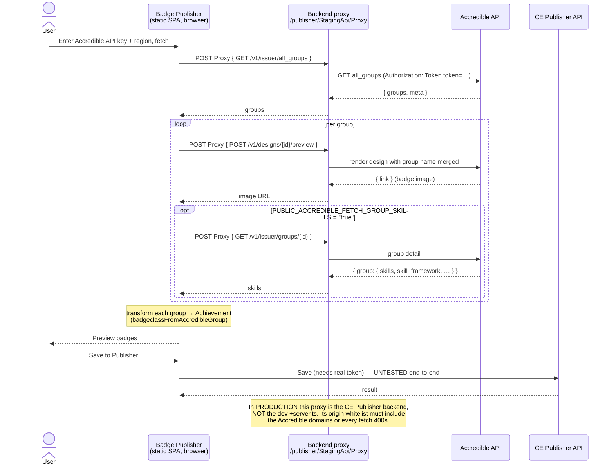

# Accredible Badge Source — Engineering Handoff

## Overview

This repo is the **Open Badge Publisher** (SvelteKit app) — it imports badges from a badge platform and republishes them to the Credential Engine Registry as CTDL linked data, via CE's Publisher API. Users pick a **badge source**, the app fetches that source's badges, transforms each into an Open Badge *Achievement*, shows a preview, and the user saves them to the Publisher.

**This change adds Accredible as a new badge source**, alongside the existing Credly and Parchment (formerly Canvas) sources. No prior review of this branch is assumed; everything you need is below.

### The Accredible flow
1. **`AccredibleConfig.svelte`** collects an Accredible **API key** + **region** (US / EU / Sandbox) and a terms checkbox.
2. **`fetchAccredibleGroups()`** (`badgeSourceStore.ts`) pages `GET /v1/issuer/all_groups` and resolves a badge image per group. Browser calls can't hit Accredible directly, so every request goes through the app's **server-side proxy** (`StagingApi/Proxy/+server.ts`), which forwards with the `Authorization: Token token=<key>` header. The proxy has an **origin whitelist** — the three Accredible API domains were added to it.
3. **`badgeclassFromAccredibleGroup()`** (`accredible.ts`) converts each Accredible "group" (a badge template) into the Achievement shape the app's `badgeClassBasicSchema` validates.
4. The existing Publisher UI previews the results and **saves them to the CE Publisher** (requires a real, environment-issued token).



---

## What changed, and why

The Accredible API shapes are **verified against the official OpenAPI spec** (`github.com/accredible/api-documentation`, `openapi.json`; the old `docs.accredible.com` no longer resolves). Three decisions came out of that:

1. **Alignments (skills) are read from `skills[]`, not `learning_outcomes`.** Badge Publisher's importer requires a valid `targetUrl` on *every* alignment entry and rejects the whole achievement if one is missing. A group's `learning_outcomes` is an array of **bare strings** (no URL) or `null`, so every alignment built from it is dropped — in a 316-item sample, 255 (81%) lost all skills for exactly this reason. The URL-bearing data lives in the group's **`skills[]`** (each has a public `url`, `name`, `identifier`, `description`) plus a `skill_framework`. `badgeclassFromAccredibleGroup()` now maps those to `targetUrl`/`targetName`/`targetCode`/`targetDescription`/`targetFramework`. Groups with only free-text skills still produce no alignments — correct, not a bug.

2. **Fetching `skills[]` is opt-in** (`PUBLIC_ACCREDIBLE_FETCH_GROUP_SKILLS`, default `"false"`). `skills[]` is returned **only** by the single-group `GET /v1/issuer/groups/{id}` — not the list endpoint — *and* it's a **pay-gated** Accredible feature most badges leave empty. So pulling it costs one extra API call per group for data that's usually absent. It's off by default; `earning_criteria` and `achievement_type` come back on the list regardless, so turning it off loses nothing else.

3. **Badge image comes from the design *preview* endpoint.** The spec documents no design-GET response and no `rasterized_content_url`; the only documented image source is `POST /v1/designs/{id}/preview` → `{ "link": ... }` (renders the design with the group's name merged in). That `link` is now the primary image URL, with the design GET kept only as a best-effort fallback. **Confirmed working against the sandbox** — badges render populated, so the name-merge keys are correct; the open question is only URL durability (see "Must verify" #2).

Earlier commits on the branch also added: the Accredible source UI and its registration as a selectable source; the proxy whitelist entries; `earning_criteria` normalization (it can be a string *or* a structured array — passing the array straight to `markdownToTxt()` previously threw and silently dropped the credential); and a **dev login bypass** (see Appendix A).

---

## Deploying to CE production

The production build is a **static SPA** (`@sveltejs/adapter-static`, `200.html` fallback) deployed to IIS. The `src/routes/publisher/StagingApi/*` endpoints are **dev-only** — they run under `vite dev` but are **not part of the static build**. In production, those `/publisher/StagingApi/*` paths are served by the **real CE Publisher backend**; the dev routes just let you develop without it.

Consequences for integrating this feature:

1. **⚠️ Whitelist the Accredible origins in the production backend proxy — this is the key step and it's in a different codebase.** The `ORIGIN_WHITELIST` edit in `StagingApi/Proxy/+server.ts` only affects local dev. The production proxy (the CE Publisher backend serving `/publisher/StagingApi/Proxy`) must independently allow `https://api.accredible.com`, `https://eu.api.accredible.com`, and `https://sandbox.api.accredible.com`. Without it, every Accredible fetch 400s in production — the exact failure the dev whitelist fixed.
2. **Production env/config:** `ADAPTER_STATIC="true"`, `PUBLIC_DEV_BYPASS_PUBLISHER_LOGIN` off (or absent), `PUBLIC_UI_API_BASEURL` pointing at the backend, and a decision on `PUBLIC_ACCREDIBLE_FETCH_GROUP_SKILLS`.
3. **Flags are build-time in a static build.** Both the dev bypass and the skills flag read `$env/dynamic/public`, which has no runtime source in a static build (no Node server), so they resolve to their defaults (off) in production — safe as-is. But **enabling the skills flag on a deployed instance isn't a runtime toggle**: it needs a build-time var (ideally moved to `$env/static/public`) and a rebuild.
4. **Scale / rate limits:** image resolution is one proxied call per group, and skills (if enabled) adds another per group. A large issuer (hundreds–thousands of groups) means that many sequential calls through the backend proxy — mind Accredible's rate limits and consider batching/caching before enabling at scale.
5. **Image durability:** the preview `link` may be a signed/expiring URL. CTDL requires a durable, publicly reachable image URL, so CE may need to re-host badge images rather than reference Accredible's preview URL long-term.

---

## Verified vs. not verified

| | Status |
|---|---|
| API auth, region domains, endpoints, response shapes | ✅ verified against `openapi.json` |
| Code compiles | ✅ `npm run check` adds no new errors (see Build status) |
| Fetch → transform → **preview** | ✅ manually tested against an Accredible **sandbox** account |
| Image resolves via design preview & renders populated (not blank) | ✅ confirmed against **sandbox** (the name-merge works) |
| **Save/publish to a real Publisher** | ❌ never run (see below) |
| Image URL is durable / non-expiring | ❌ not verified — preview links appear signed/tokenized |
| `skills[]` populates with usable URLs | ❌ not verified (pay-gated; sandbox account lacks it) |

**Why publish is untested:** local Publisher environments use Keycloak/OIDC, which the app's email/password login no longer supports. Local testing used the dev bypass (Appendix A), which injects a fake token — so fetch + preview work, but the real "Save to Publisher" step has never executed end-to-end.

**Build status:** `npm run check` reports pre-existing, project-wide type errors (in `publisherStore.ts`, `BadgeSelection.svelte`, the `StagingApi` routes, `badges.ts`, etc.) that are unrelated to this work; the Accredible files themselves are clean. Diff the error count against `main` to confirm this branch adds none. `lint`/`build` were not run here — run them in CI.

---

## Must verify before production

1. **One real publish** — fetch from Accredible and save to a Publisher environment with a real token. This is the only untested link in the chain.
2. **Image URL durability** — images resolve and render populated against sandbox, so the remaining risk is **expiry**: the preview `link` looks signed/tokenized (`…/design/image?...&data=…`), which can render today and 404 later. Since CTDL stores the URL for consumers to resolve much later, confirm whether these links persist (re-open one after hours/days) or whether CE must re-host the image instead.
3. **Skills** (only if targeting a paid account) — set `PUBLIC_ACCREDIBLE_FETCH_GROUP_SKILLS="true"` and confirm `skills[]` carries absolute `url`s that survive import.
4. **Add tests** — `vitest` is configured but there are none for this integration. Highest value, both pure functions in `accredible.ts`: `narrativeFromEarningCriteria()` (string-vs-array normalization) and `badgeclassFromAccredibleGroup()` (alignment mapping/filtering).
5. **Decide on the dev bypass** — keep it (ships disabled) or strip it before merge (Appendix A).

---

## File map

Files that make up the Accredible feature:

| File | Role |
|---|---|
| `src/lib/utils/accredible.ts` | Region table, group→Achievement transform, `skills[]`/`earning_criteria` normalization, design-image resolution, endpoint builders. |
| `src/lib/partials/AccredibleConfig.svelte` | Source config UI (API key, region, terms). |
| `src/lib/partials/BadgeSourceConfig.svelte` | Registers Accredible as a selectable source. |
| `src/lib/stores/badgeSourceStore.ts` | `fetchAccredibleGroups()`: paging, per-group conversion (one bad badge can't wipe the import), image lookup, opt-in skills GET. |
| `src/lib/stores/publisherStore.ts` | Supporting store changes for the Accredible flow. |
| `src/lib/partials/PublisherConfig.svelte` | Dev login bypass (Appendix A); clearer error on a non-JSON (Keycloak) login response. |
| `src/routes/publisher/StagingApi/Proxy/+server.ts` | Accredible API regions added to the proxy origin whitelist (without them every fetch 400s). |
| `.env.example` / `local.env` | New `PUBLIC_DEV_*` and `PUBLIC_ACCREDIBLE_FETCH_GROUP_SKILLS` keys (all default off). |
| `accredible_probe.py` | Standalone verification script (Appendix B). |

> **Uncommitted at handoff:** `accredible.ts`, `badgeSourceStore.ts`, `.env.example`, `local.env`, `.gitignore`, `README.md`, `HANDOFF.md`, `accredible_probe.py`. (`package-lock.json` shows modified but predates this work — leave it out.) Commit these before review.

---

## Appendix A — Dev login bypass

Gated behind `PUBLIC_DEV_BYPASS_PUBLISHER_LOGIN` (default `"false"`). When `"true"`, the login screen shows a **"Skip login (dev)"** button that injects a fake publisher session (fake org + `DEV_FAKE_TOKEN`) so badge-source workflows can be exercised locally without a working Publisher login. The button is wrapped in `{#if devBypassEnabled}` in `PublisherConfig.svelte`, so it's a no-op in any normal build.

**To reproduce the manual testing:** set `PUBLIC_DEV_BYPASS_PUBLISHER_LOGIN="true"` in `.env` → `npm run dev` → **Skip login (dev)** → choose **Accredible**, enter API key + region, accept terms, fetch. You'll reach preview; **Save will fail** (it needs a real token — expected).

To strip it before production: remove the flag, the `devBypassLogin()` function, the `{#if devBypassEnabled}` block (all in `PublisherConfig.svelte`), and the three `PUBLIC_DEV_*` keys.

## Appendix B — `accredible_probe.py`

A standalone, stdlib-only script (no `pip install`) that talks straight to Accredible's API — no app, login, or proxy. Useful for inspecting raw payloads against a real account:

```bash
python3 accredible_probe.py --api-key YOUR_KEY --env sandbox
# or: ACCREDIBLE_API_KEY=... python3 accredible_probe.py --env us
```

It prints the raw `all_groups` and design payloads and writes a transformed Achievement array to `accredible_achievements_probe.json` (gitignored; regenerable), which can be pasted into the app's **"JSON" source type** as a manual test. The API key is read from `--api-key`/`ACCREDIBLE_API_KEY` only — nothing hardcoded. Note: the probe mirrors the *earlier* transform (reads `learning_outcomes`, no per-group skills GET), so it's for inspecting raw API data, **not** a mirror of the current alignment logic — the in-app fetch is the real test.

## Appendix C — Env & secrets

- `local.env` is a **tracked template with empty values**, by design — `README.md` tells devs to copy `local.env` → `.env` (which is gitignored). Real secrets go in `.env`, never in `local.env`.
- The Accredible API key is user-entered in the UI and forwarded through the proxy; it is not stored server-side.
